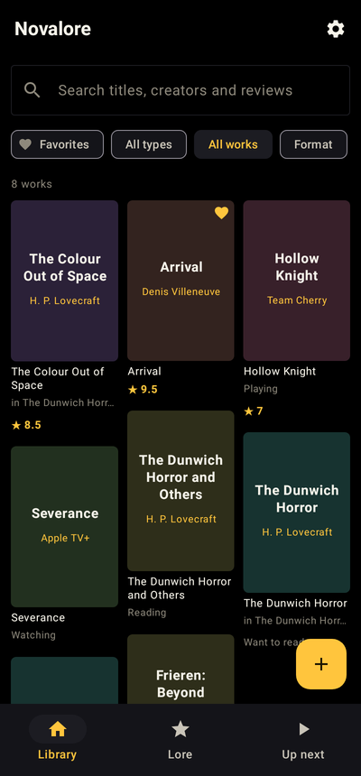
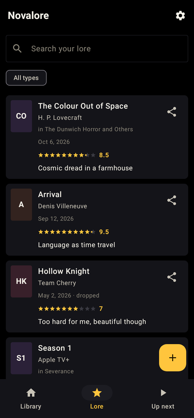
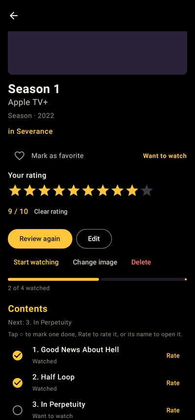
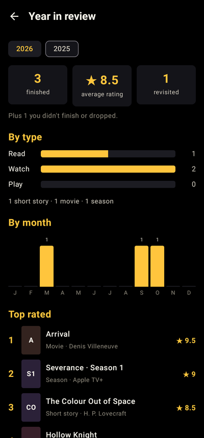
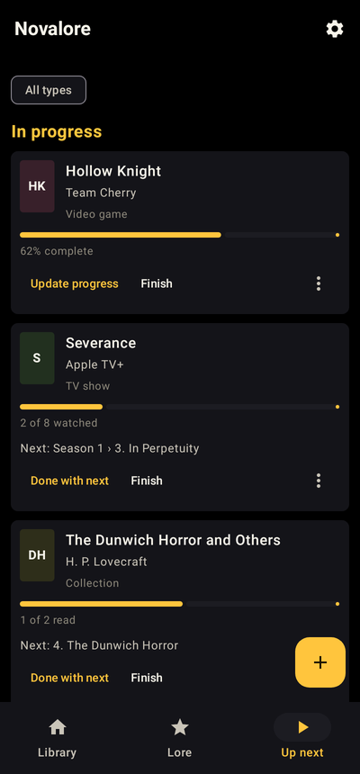
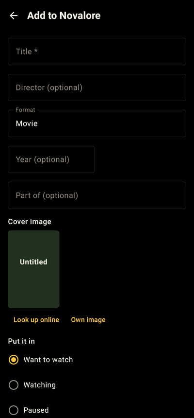
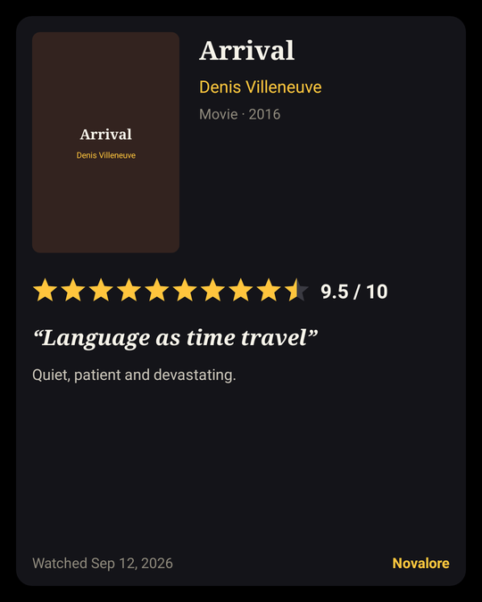

<p align="center">
  
</p>

<h1 align="center">Novalore</h1>

<p align="center">
  <b>A review journal for every story you take in.</b><br>
  Books and short stories, manga and comics, movies, TV and anime, and video games: log them, rate them, review them, and come back to review them again.
</p>

<p align="center">
  <a href="https://github.com/DoctorKnepper/Novalore/actions/workflows/build.yml"></a>
</p>

<p align="center">
  
  
  
  
</p>

## Features

- **Every kind of story.** Formats are grouped into **Read** (short stories through novels, nonfiction, collections, anthologies, manga, comics, volumes, chapters, issues), **Watch** (movies, documentaries, TV shows, seasons, episodes, anime) and **Play** (video games, DLC). The wording follows the type: *Watched*, *Want to play*, *Dropped*, *Director*, *Studio*, *Played on*…
- **Review anything at any level.** A show, each season and each episode (or a manga, its volumes and its chapters) can each be rated and reviewed on its own, and reviewed again later. Ten stars with half steps.
- **Fill in a whole show.** Pull every season and episode from TVmaze, or add a numbered run (episodes 1–12, volumes 1–41). Tick parts off with one tap; finishing every episode finishes the season.
- **Online lookup by type** for covers, years, creators and lengths: TVmaze (TV, anime), AniList (anime, manga), Wikipedia (movies, documentaries, games), Open Library and Google Books (books, comics). No accounts or API keys.
- **Covers that fit.** Each cover gets a tall, square or wide frame to match its image, so game boxes and posters are never cut off.
- **Lore**, your reviews newest first, with search and a type filter; **Up next** for what's in progress, what's next and what's paused.
- **Share a review** to any app, with a spoiler switch and an optional review card that puts the cover, stars and verdict in one image.
- **Year in review** with totals, revisits, a month-by-month chart, top rated and most-reviewed creators, plus a shareable summary.
- **Appearance settings.** OLED Black and amber by default, with other backgrounds, accents and text colors. Every combination keeps text readable.
- **Yours, on your phone.** No account, no ads, no tracking. Backups (zip) and CSV export/import, including Goodreads and StoryGraph exports.

<p align="center">
  
  
  
</p>

## Install

- **Google Play:** coming soon.
- **Download:** get the APK from the [latest release](https://github.com/DoctorKnepper/Novalore/releases/latest) and open it on your phone (Android 8.0 or newer; allow installs from that source when asked).
- **Latest test build:** every push to `main` builds a debug APK. Open the latest successful run under [Actions](https://github.com/DoctorKnepper/Novalore/actions/workflows/build.yml) and download **novalore-debug-apk**. Each of these is signed with a throwaway key, so to switch between them you may need to uninstall first (back up your library before you do).

Coming from **Storybox** (the app's earlier name)? Novalore installs alongside it. In Storybox use *Export backup*, then in Novalore choose *Restore a Novalore or Storybox backup*.

## Build from source

Requirements: JDK 17 or newer and the Android SDK (platform 35). Android Studio provides both.

```sh
./gradlew assembleDebug            # app/build/outputs/apk/debug/app-debug.apk
./gradlew testDebugUnitTest        # unit tests and screen tests
```

The tests include Robolectric screen walk-throughs that render the real UI and save screenshots to `app/build/screens/`. Robolectric downloads an Android system image on first run; on a machine that can't, download the `android-all-instrumented` jars yourself and set `ROBOLECTRIC_DEPS` to their folder.

Release builds are signed from a `keystore.properties` file in the project root (git-ignored) with `storeFile`, `storePassword`, `keyAlias` and `keyPassword`. Without it, release builds are unsigned.

## Project layout

All app code is in `app/src/main/java/com/rook/novalore/`:

| File | What's in it |
|---|---|
| `Model.kt` | The library: works, reviews, collections and parts, progress, ratings, year-in-review stats |
| `Media.kt` | Formats and their groups, wording, progress units and lookup services |
| `Store.kt`, `Json.kt`, `SafeFiles.kt` | Saving to disk, backups, and the path and size checks on anything imported |
| `Csv.kt` | CSV export and import (Novalore, Storybox, Goodreads, StoryGraph) |
| `Net.kt`, `CoverShapes.kt` | Online lookups, cover downloads, image cache and cover shapes |
| `MainActivity.kt` | Navigation, the Library, Lore and Up next tabs |
| `Screens.kt` | Work page, add/edit form, review editor, lookup dialog |
| `FillIn.kt`, `QuickRate.kt` | Filling in seasons and episodes, quick rating |
| `Share.kt`, `YearInReview.kt` | Sharing, the review card and Year in review |
| `Theme.kt`, `AppearanceScreen.kt`, `Components.kt` | Colors and appearance settings, shared UI pieces |

## Privacy

Novalore keeps everything on your device. See the [privacy policy](PRIVACY.md).

## Changes

See [CHANGELOG.md](CHANGELOG.md).

## License

Novalore is released under the [MIT License](LICENSE). The name "Novalore" and its icon identify this app; please give forks their own name and icon.
